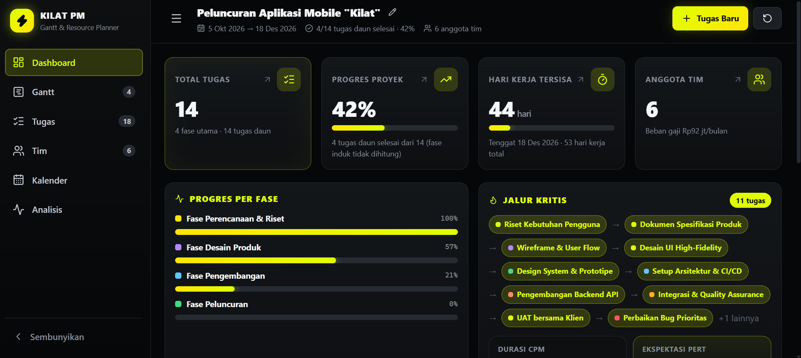
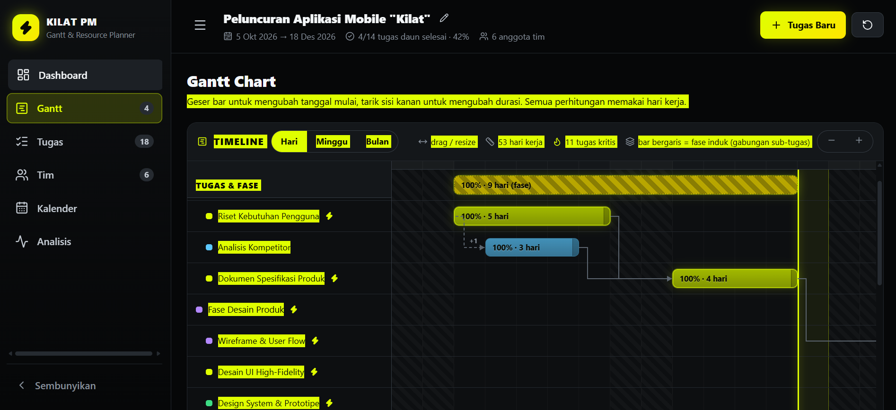

# KILAT PM — Manajemen Proyek Berbasis Gantt Chart

Aplikasi manajemen proyek lengkap dengan **Gantt Chart interaktif**, perhitungan **hari kerja**
(weekend & hari libur dilewati), **jalur kritis (CPM)**, **diagram PERT**, dan **manajemen
resource**. Dibangun dengan React + TypeScript + Vite, bertema neon kuning di atas latar hitam.

---

## 1. Cara Install & Menjalankan

Prasyarat: **Node.js 20+** dan npm.

```bash
# 1. Install dependensi
npm install

# 2. Jalankan mode pengembangan (http://localhost:5173)
npm run dev

# 3. Build untuk produksi
npm run build

# 4. Pratinjau hasil build
npm run preview
```

### Perintah lainnya

| Perintah | Fungsi |
| --- | --- |
| `npm run dev` | Menjalankan server pengembangan Vite dengan hot reload |
| `npm run build` | Typecheck (`tsc -b`) lalu build produksi ke folder `dist/` |
| `npm run preview` | Menyajikan hasil build produksi secara lokal |
| `npm run typecheck` | Menjalankan TypeScript compiler untuk memeriksa tipe tanpa emit |
| `npm run test` | Menjalankan seluruh unit & smoke test (Vitest) |
| `npm run lint` | Menjalankan oxlint |

Semua data tersimpan otomatis di **localStorage** browser (key `gantt.pm.data.v1`).
Saat pertama kali dibuka, aplikasi memuat **data contoh** (proyek peluncuran aplikasi mobile)
berisi 18 tugas, 6 anggota tim, 15 dependensi, dan 3 hari libur. Data tersimpan selalu diberi
penanda `SEED_VERSION`; bila versinya tidak ada atau berbeda dari seed saat ini, data lama diganti
data contoh terbaru otomatis (tanpa perlu menekan tombol reset).

---

## 2. Ringkasan Fitur

### 📋 Manajemen Tugas
- Tambah / edit / hapus tugas lengkap dengan deskripsi.
- **Durasi dalam hari kerja** — akhir pekan dan hari libur khusus otomatis dilewati.
- Tanggal mulai, **prioritas** (Tinggi / Sedang / Rendah), **warna indikator** (palet + color
  picker), status, dan progres 0–100%.
- **Sub-tugas (parent-child)** tanpa batas kedalaman, ditampilkan bertingkat di daftar tugas dan
  di Gantt.
- **Fase induk tidak dijadwalkan dari durasinya sendiri** — tanggal mulai = mulai paling awal
  sub-tugas, tanggal selesai = selesai paling akhir sub-tugas, float & status kritis diturunkan
  dari sub-tugas, dan progresnya adalah rata-rata berbobot durasi sub-tugas. Di Gantt bar fase
  digambar bergaris (ringkasan) dan tidak bisa digeser/di-resize.
- Validasi form yang jelas (nama minimal 3 karakter, durasi 1–500 hari, progres 0–100, urutan
  estimasi PERT O ≤ M ≤ P) dengan penanda error per kolom.
- Filter berdasarkan pencarian, prioritas, status, dan anggota tim.

### 🔗 Predecessors & Timeline (Gantt Chart)
- Hubungan **Finish-to-Start (FS)** dan **Start-to-Start (SS)** beserta **jeda / lag hari kerja**.
- Deteksi otomatis **siklus dependensi** — hubungan yang membentuk lingkaran ditolak.
- Gantt Chart visual: bar tugas berwarna, overlay progres, dan **panah dependensi** (garis putus
  untuk SS) yang **menyala kuning neon saat tugas dipilih**.
- **Drag bar** untuk mengubah tanggal mulai dan **tarik sisi kanan bar** untuk mengubah durasi —
  hasilnya otomatis di-snap ke hari kerja terdekat.
- **Tooltip** pada bar: nama, tanggal mulai/selesai, durasi hari kerja, penanggung jawab,
  prioritas, status, dan total float.
- Zoom **Hari / Minggu / Bulan**, penanda akhir pekan & hari libur, garis "hari ini", legenda, dan
  scroll horizontal yang nyaman.

### 👥 Manajemen Resource
- Pendaftaran anggota tim: **nama, email, peran, dan gaji** (validasi format email).
- Alokasi anggota ke tugas tertentu langsung dari form tugas (multi-pilih).
- Kartu anggota menampilkan avatar inisial, beban kerja (rata-rata progres), jumlah tugas, dan
  tag tugas yang diampu.
- Statistik total & rata-rata gaji per bulan, serta jumlah tugas tanpa penanggung jawab.
- Menghapus anggota otomatis melepas alokasinya dari seluruh tugas.

### 📅 Kalender Proyek
- Pengaturan **akhir pekan** fleksibel (hari apa pun bisa dijadikan bukan hari kerja).
- Penambahan **hari libur khusus**; bisa juga dengan mengklik tanggal di kalender bulanan.
- Kalender bulanan interaktif dengan penanda akhir pekan, hari libur, hari ini, dan titik warna
  tugas yang berjalan pada tanggal tersebut.
- Semua durasi tugas **hanya menghitung hari kerja** dan otomatis dijadwalkan ulang setiap kali
  kalender berubah.

### 📈 Analisis Proyek
- **Jalur kritis (Critical Path Method)** lengkap: forward pass & backward pass, tanggal
  tercepat/terlambat, **total float** dan **free float** per tugas.
- **Diagram jaringan PERT** berbentuk kolom sesuai kedalaman dependensi, **hanya memuat tugas
  daun** — fase induk tampil sebagai label pengelompok di atas node anaknya, bukan sebagai node.
- **Panah dependensi SVG** antar node dengan **label FS/SS + lag** (garis putus-putus untuk SS);
  node dan panah jalur kritis disorot **kuning neon**.
- Node menampilkan **tanggal sebagai angka utama** (`5 Okt 2026 → 9 Okt 2026`) dan indeksnya
  ditulis **“Hari ke-1 s/d ke-5”** — dimulai dari 1, bukan 0.
- **Legenda di atas diagram** untuk ES, EF, LS, LF, Float, Te, dan CP dalam bahasa sederhana,
  lengkap dengan tooltip penjelasan.
- **Estimasi 3 titik PERT** (Optimis, Paling Mungkin, Pesimis) → durasi harapan `(O + 4M + P) / 6`,
  variansi, standar deviasi, dan **peluang penyelesaian** proyek sesuai durasi CPM.
- **Total durasi PERT = jumlah Te sepanjang satu rantai kritis yang berurutan** — bukan seluruh
  tugas kritis — sehingga tugas kritis paralel (mis. Start-to-Start) tidak dihitung dua kali. Bila
  Te melebihi durasi CPM, aplikasi menjelaskan bahwa Te adalah nilai harapan, bukan durasi
  terjadwal.
- Tabel CPM (termasuk baris gabungan sub-tugas) dan tabel PERT (tugas daun + penanda rantai kritis),
  dengan baris jalur kritis ditandai aksen neon.
- Peringatan visual jika terdeteksi siklus dependensi.

### 🎨 Antarmuka & Interaksi
- Tema **kuning neon (`#DFFF00`) + hitam** — energik, kontras, dan mudah dibaca.
- Sidebar navigasi **dapat di-collapse**, berubah menjadi **bottom navigation** di layar kecil;
  header berisi nama proyek (klik ikon pensil untuk ganti), tombol tambah tugas cepat, dan tombol
  reset ke data contoh.
- **Warna prioritas** seragam di badge, legenda (di atas daftar tugas), dan garis kiri kartu tugas:
  Tinggi merah (`#ff3b3b`), Sedang oranye (`#ff8a1f`), Rendah biru (`#3ea6ff`). Warna fase tetap
  terlihat sebagai titik kecil di samping nama tugas, sedangkan kuning neon khusus jalur kritis.
- Ikon `lucide-react` di navigasi, tombol, kartu statistik, badge prioritas/status, dan empty state.
- Animasi halus: fade/slide pada modal & daftar, transisi antar halaman, efek glow neon pada
  hover kartu dan tombol, toast notifikasi untuk setiap tambah/ubah/hapus.
- **Konfirmasi sebelum menghapus**, fokus keyboard yang terlihat, dan menghormati
  `prefers-reduced-motion`.

---

## 3. Panduan Mengubah Warna Tema

Seluruh warna didefinisikan sebagai **CSS variables** di bagian `:root` pada
[`src/index.css`](src/index.css). Cukup ubah nilainya — tidak perlu menyentuh komponen.

```css
:root {
  /* Aksen neon — ganti di sini untuk mengubah seluruh nuansa aplikasi */
  --neon: #dfff00;        /* kuning neon utama */
  --neon-alt: #ffe600;    /* variasi untuk gradasi tombol & progress bar */
  --neon-dim: rgba(223, 255, 0, 0.16);
  --neon-line: rgba(223, 255, 0, 0.4);
  --neon-glow: rgba(223, 255, 0, 0.45);
  --on-neon: #0a0c00;     /* warna teks di atas aksen neon */

  /* Latar */
  --bg-0: #060708;        /* latar paling gelap */
  --bg-1: #0d0f11;        /* panel & sidebar */
  --bg-2: #14171a;        /* kartu */
  --bg-3: #1c2025;        /* elemen terangkat / hover */

  /* Teks */
  --text-0: #f4f7f9;      /* teks utama */
  --text-1: #c3cad2;
  --text-2: #868f9a;

  /* Prioritas (badge, legenda, garis kiri kartu tugas) */
  --prio-high: #ff3b3b;   /* versi redup: --prio-high-dim / --prio-high-line */
  --prio-medium: #ff8a1f;
  --prio-low: #3ea6ff;
}
```

### Contoh cepat

**Nuansa biru neon:**
```css
--neon: #00e5ff;
--neon-alt: #4df3ff;
--neon-dim: rgba(0, 229, 255, 0.16);
--neon-line: rgba(0, 229, 255, 0.4);
--neon-glow: rgba(0, 229, 255, 0.45);
--on-neon: #001014;
```

**Nuansa ungu neon:**
```css
--neon: #b47cff;
--neon-alt: #d0a6ff;
--neon-dim: rgba(180, 124, 255, 0.16);
--neon-line: rgba(180, 124, 255, 0.4);
--neon-glow: rgba(180, 124, 255, 0.45);
--on-neon: #100018;
```

**Tema terang (light mode):** ubah `--bg-*` menjadi warna terang dan `--text-*` menjadi gelap, lalu
ganti `color-scheme: dark` menjadi `light`. Warna aksen neon dapat dipertahankan.

> 💡 **Tips:** warna indikator bar Gantt tiap tugas diambil dari kolom `color` pada data tugas,
> sehingga tidak terpengaruh perubahan tema di atas. Palet pilihannya ada di `DEFAULT_COLORS`
> pada [`src/types.ts`](src/types.ts).

Variabel lain yang bisa disesuaikan: `--radius` (kebulatan sudut), `--speed` (durasi animasi),
`--sidebar-w` (lebar sidebar), dan `--font` (jenis huruf).

---

## 4. Struktur Proyek

```
├── index.html
├── vite.config.ts            # konfigurasi Vite + Vitest
├── .gitignore                # node_modules, dist, cache, .env
├── src/
│   ├── main.tsx              # entry point
│   ├── App.tsx               # layout shell, routing antar halaman
│   ├── index.css             # TEMA (CSS variables) + seluruh gaya & animasi
│   ├── types.ts              # tipe domain & konstanta label
│   ├── data/
│   │   ├── seed.ts           # data contoh proyek
│   │   └── seed.test.ts      # uji integritas seed + gabungan fase induk (15 kasus)
│   ├── lib/
│   │   ├── dateUtils.ts      # matematika kalender hari kerja
│   │   ├── dateUtils.test.ts # unit test (16 kasus)
│   │   ├── ganttDrag.ts      # matematika drag & resize bar Gantt (fungsi murni)
│   │   ├── ganttDrag.test.ts # unit test (20 kasus)
│   │   ├── scheduling.ts     # CPM, jalur kritis, float, PERT, gabungan fase induk
│   │   └── scheduling.test.ts# unit test (21 kasus)
│   ├── store/
│   │   ├── projectContext.ts # kontrak state proyek
│   │   ├── ProjectProvider.tsx # state + persistensi localStorage
│   │   ├── ProjectProvider.test.tsx # uji store (19 kasus)
│   │   ├── uiContext.ts      # kontrak toast & dialog konfirmasi
│   │   └── UiProvider.tsx    # implementasi toast + confirm
│   ├── components/
│   │   ├── ui.tsx            # modal, avatar, badge, progress, stat card, empty state
│   │   ├── Sidebar.tsx       # navigasi collapsible / bottom nav
│   │   ├── Header.tsx        # nama proyek, tambah cepat, reset seed
│   │   └── TaskForm.tsx      # form tugas + editor dependensi
│   ├── pages/
│   │   ├── Dashboard.tsx
│   │   ├── GanttPage.tsx     # Gantt Chart interaktif
│   │   ├── TasksPage.tsx
│   │   ├── TeamPage.tsx
│   │   ├── CalendarPage.tsx
│   │   ├── AnalysisPage.tsx  # jalur kritis, legenda, diagram PERT + panah SVG
│   │   ├── AnalysisPage.test.tsx # uji legenda, node daun, panah FS/SS (5 kasus)
│   │   ├── Dashboard.test.tsx # uji statistik tugas daun + kartu klikabel (4 kasus)
│   │   └── GanttPage.test.tsx # uji interaksi drag & resize bar (6 kasus)
│   └── App.test.tsx          # smoke test render + navigasi + validasi form
│                             #  + pemulihan data localStorage rusak
```

---

## 5. Catatan Teknis

**Perhitungan hari kerja.** Fungsi inti ada di `src/lib/dateUtils.ts`: `isWorkingDay`,
`addWorkingDays`, `addWorkingDaysOffset`, dan `countWorkingDaysInclusive`. Hari kerja = bukan
akhir pekan yang dipilih **dan** bukan hari libur khusus.

**Penjadwalan CPM.** `src/lib/scheduling.ts` membangun `WorkingCalendar` (pemetaan tanggal ↔ indeks
hari kerja), lalu menjalankan forward pass dan backward pass pada urutan topologis:

- **Forward pass** — `ES` tugas = maksimum dari (tanggal mulai yang diisi pengguna, batas dari
  setiap pendahulu), dengan `EF = ES + durasi − 1`.
  - FS: `ES_succ ≥ EF_pred + lag + 1`
  - SS: `ES_succ ≥ ES_pred + lag`
- **Backward pass** — `LS` tugas = minimum dari (tenggat proyek, batas dari setiap penerus).
  - FS: `LS_pred ≤ LS_succ − lag − durasi_pred`
  - SS: `LS_pred ≤ LS_succ − lag`
- **Float** = `LS − ES`; tugas dengan float 0 dianggap **kritis**.

**Fase induk (parent-child).** Hanya **tugas daun** yang dijadwalkan sebagai node CPM/PERT.
Fase induk adalah gabungan sub-tugas: `ES = min(ES anak)`, `EF = max(EF anak)`, `LS = min(LS anak)`,
`LF = max(LF anak)`, total float = minimum float anak, dan progresnya rata-rata berbobot durasi
anak. Dependensi yang menyentuh fase induk diterapkan ke setiap sub-tugas daunnya, dan fase induk
hanya menjadi label pengelompok di diagram PERT (bukan node).

**Rantai kritis & total PERT.** `criticalPath` memuat semua tugas daun kritis (bisa bercabang
paralel), sedangkan `criticalChain` adalah **satu rantai berurutan** hasil penelusuran penerus
kritis lewat dependensi FS/SS, dipilih berdasarkan total Te terbesar. `pertDuration` = jumlah Te
sepanjang rantai itu, jadi cabang kritis paralel tidak dihitung dua kali.

**Peluang PERT** dihitung dengan aproksimasi fungsi `erf` terhadap distribusi normal, memakai
`mean = Σ Te` dan `σ = √(Σ variansi)` sepanjang rantai kritis tersebut. Karena Te adalah nilai
harapan, hasilnya bisa lebih panjang dari durasi CPM — selisih itu dijelaskan di halaman Analisis.

**Statistik UI.** Total tugas, tugas selesai, dan progres di dashboard/header dihitung dari
**tugas daun** saja supaya fase induk tidak dihitung dua kali. Semua kartu statistik di dashboard
dapat diklik menuju halaman terkait, dengan kursor pointer, glow kuning neon saat hover, ikon
`ArrowUpRight`, dan fokus keyboard (`<button>`).

**Persistensi & pemulihan data.** `ProjectProvider` menyimpan seluruh state ke localStorage pada
setiap perubahan, bersama penanda `SEED_VERSION` dari `src/data/seed.ts`. Saat dibuka, data hanya
dipakai bila penanda versinya sama dengan seed saat ini; versi yang hilang atau berbeda membuat
data lama diganti seed baru agar perubahan data contoh langsung terlihat. Data yang dibaca selalu dilewatkan fungsi `normalize`: JSON yang tidak valid atau
tanpa array `tasks`/`resources` membuat aplikasi kembali ke seed, sedangkan tugas yang rusak sebagian
diperbaiki tanpa dibuang — `progress` dijepit 0-100, `durationDays` minimal 1, `priority`/`status`
di luar daftar resmi dikembalikan ke `medium`/`todo`, `color` kosong memakai warna tema, dan
`startDate` yang hilang atau mustahil (mis. `2026-13-45`) diganti tanggal hari ini agar tugas tetap
tampil dan bisa diperbaiki pengguna.

---

## 6. Verifikasi

```bash
npm run typecheck   # TypeScript: 0 error
npm run test        # 112 test: 16 dateUtils + 20 ganttDrag + 21 scheduling + 15 data seed
                    #          + 20 store (normalisasi, versi seed, cascade delete, kalender)
                    #          + 6 interaksi Gantt (drag/resize) + 5 analysis + 4 dashboard
                    #          + 5 smoke test UI
npm run build       # tsc -b && vite build -> dist/
```

Semua perintah di atas lolos tanpa error.

## 7. Tampilan

  
  